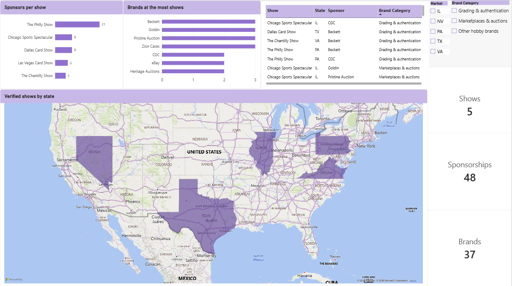
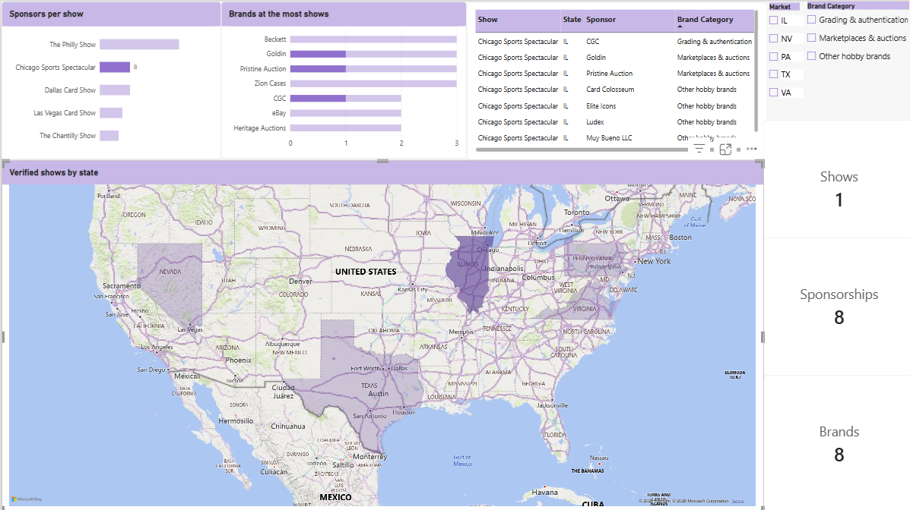

# Card Show Sponsor Report

**Turning scattered show and sponsor lists into a brand-ready report.**

A sample analytics project built with public card show data. It answers one question a sponsorship platform deals with every day: how do you turn scattered show, sponsor and brand lists into something a brand can use to decide where to spend its show budget?

🔗 **[Interactive web report](https://isabelnavabv.github.io/card-show-sponsor-report/report.html)** (no Power BI needed). You can also download `report.html` and open it in any browser.

---

## The process

### 1. Review the data
I started from a working list of 13 US card shows and checked each one against the show's official website. A show stays in the dataset only if its sponsor list is published and could be confirmed.

| Result | Shows |
|---|---|
| ✅ Kept: published, verified sponsor list | 5 |
| ⏸️ Pending: sponsor list not yet verified | 1 |
| ❌ Excluded: no published sponsor list, or no show found under that name | 7 |

### 2. Clean it up
- **One brand, one name.** The same company is written differently across websites (`Zion` / `ZION Cases`, `eBay Live` / `eBay`, `CGC Cards` / `CGC x JSA`). 10 rows were standardized so brand counts are not split across spellings.
- **One row per sponsorship** (long format) instead of all sponsors in one cell.
- **Sponsor vs. exhibitor.** Some brands are listed as vendors without sponsoring. Only official sponsors are counted.
- **Every row keeps its source and date**, because sponsor lists change during the season.

### 3. Organize it
One clean table that can be filtered by market, brand or show:

| Field | Description |
|---|---|
| `show` | Show name |
| `city`, `state` | Location |
| `schedule` | Next or most recent edition |
| `sponsor` | Standardized brand name |
| `sponsor_as_published` | Name exactly as written on the show's website |
| `brand_category` | Grading & authentication, Marketplaces & auctions, or Other hobby brands |
| `source_url` | Where the sponsor list was taken from |
| `verified_on` | Date the source was checked |

### 4. Look for opportunities
For any brand: where it already sponsors, where a competitor in the same category is present, and which shows have no brand from that category yet.

**Example, PSA:** PSA is not an official sponsor at any of the 5 verified shows, while direct grading competitors are: **Beckett** sponsors 3 of them and **CGC** sponsors 2.

### 5. Build the summary
A ranked list of shows for the selected brand, with the reason for each. Ranking rule: shows where the brand is absent, ordered by sponsor activity as a proxy for show size. Shows with an unconfirmed venue go last.

**Recommendation for PSA:** start with **The Philly Show** (21 sponsors). It is the most active show where PSA is not a sponsor, and Beckett and CGC already sponsor there. The show's website also lists PSA under "Philly Show Vendors" ([source](https://www.phillyshow.com/); the page does not say which edition), so sponsorship would be a step up from an existing presence.

---

## Key numbers

| Metric | Value |
|---|---|
| Verified shows | 5 |
| Sponsorships (show × sponsor rows) | 48 |
| Distinct brands | 37 |
| Brands at 3 of 5 shows | Beckett, Goldin, Pristine Auction, Zion Cases |

## Results: from a scattered list to sales leads
| Group | Brands | What to do |
|---|---|---|
| Sponsor only 1 of the 5 shows | 30 | Offer them more shows |
| Already invest in 2–3 shows | 7 | Proven sponsors, easiest to pitch |
| Pitch ready today | 1 (PSA) | Its competitors are at the shows, it isn't |

## Clean data is the product
- **A Brand Database you can sell.** Every row has a source and a date, so when a brand asks "how do you know?", the answer is one click away.
- **Faster sponsor pitches.** With standardized brand names, a pitch like "your competitors sponsor these 3 shows, you sponsor none" takes minutes instead of hours.
- **A map that stays current.** The `verified_on` date shows which shows need to be re-checked before they go stale.
- **Ready for user data.** Once shows and brands have one consistent name, clicks, saved shows and attendance can be linked to them.

## Next step: with audience data
Public data shows **who sponsors**. Audience data (for example from a collector app or ticket sales) shows **who shows up**. With user tracking (clicks, saved shows, attendance, searches), the same report could add:
- Users who saved each show
- Users within 50 miles of each show
- Most searched brands near each show
- Attendance trends over time

If I were a brand deciding where to sponsor, I'd want three things: **attendance** (how many people go), **audience match** (how many of them could be my customers) and **competitors there**. The last one can already be measured with public data.

## Tools
- **Google Sheets**: data collection, cleaning and standardization
- **Power BI**: data model, DAX measures (`DISTINCTCOUNT`, `COUNTROWS`), interactive dashboard
- **Web report**: interactive HTML page built from the same clean dataset, with AI assistance

## Files
| File | Description |
|---|---|
| `data/card_show_sponsors_clean.csv` | Clean dataset (48 rows) |
| `report.html` | Interactive web report |
| `card_show_sponsors_dashboard.pbix` | Power BI dashboard |
| `dashboard_overview.png` | Dashboard screenshot |
| `dashboard_filtered_IL.png` | Dashboard filtered to one market |

## Sources
Sponsor lists as published on each show's official website, checked October 15, 2026. Lists can change during the season. Brand categories were assigned by the analyst.
- [The Philly Show](https://www.phillyshow.com/)
- [Dallas Card Show](https://dallascardshow.com/)
- [Chicago Sports Spectacular](https://chicagosportsspectacular.com/pages/sponsors)
- [The Chantilly Show (CSA)](https://www.csashows.com/)
- [Las Vegas Card Show](https://lasvegascardshow.com/)

---

**Isabel Nava** · Data Analyst
